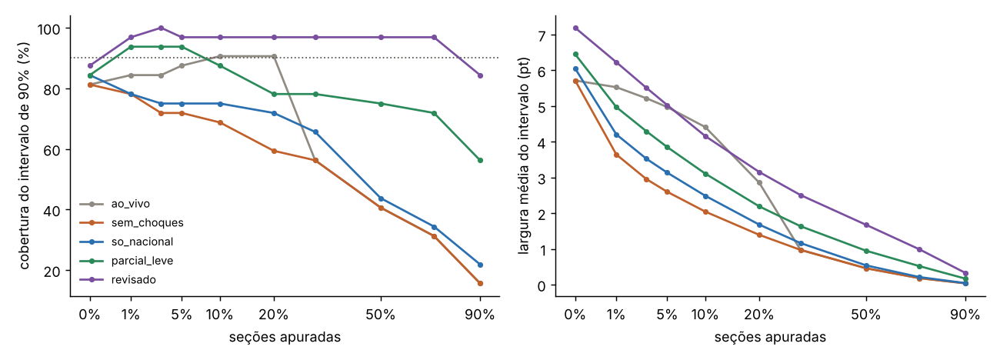

# Teste de estresse com apurações sintéticas (etapa 4, parte 1)

Em vez de ordens de apuração fixas (como a "adversa", que ordenava as seções pelo próprio voto), o teste agora
sorteia **muitas eleições e muitas apurações plausíveis** e mede se o intervalo de 90% contém o resultado ~90%
das vezes em cada momento da apuração. Código: `eleicoes/modelos/estresse.py` e `scripts/estresse.py`.

## Como uma apuração sintética é sorteada

Base: 2º turno de 2022 por seção (472 mil seções) e 1º turno por município.

1. **Resultado de cada cidade.** Parte da margem mais provável (previsão da priori para a cidade) e soma, na
   escala logit da fração de A nos válidos:
   - desvio nacional (desvio-padrão 0,12, ~3 pontos);
   - desvio por região (0,02) e por UF (0,03);
   - desvio da cidade, sorteado entre os desvios reais de 2022 de cidades do mesmo porte (caudas reais).
   Cada seção mantém o desvio real que teve em relação à sua cidade; comparecimento e brancos/nulos ficam como em
   2022.
2. **Ordem de apuração.** Base parecida com a real (regiões e capitais com atraso, zonas em blocos), mais dois
   vieses sorteados:
   - **entre cidades (beta)**: cidades previstas para um lado apuram mais rápido (velocidade x exp(beta·z));
   - **dentro das cidades (gama)**: as seções mais para um lado que a própria cidade apuram antes.

## Calibração com a apuração real de 2026

`python scripts/estresse.py --calibrar` mede na noite de 2026:

| % apurado | Cidades pró-Flávio / pró-Lula (velocidade) | Parciais das cidades − final da cidade |
|---|---|---|
| 1,6% | 1,09 | +0,96 pt |
| 5,7% | 1,30 | +0,53 pt |
| 10% | 1,31 | +0,17 pt |
| 29% | 1,27 | −0,30 pt |
| 70% | 1,04 | −0,19 pt |

- A base da ordem sem viés (beta = 0) reproduz a razão de ~1,3; beta é sorteado com desvio 0,10 (razão entre 0,8
  e 2,3).
- Gama é sorteado com desvio 0,05, o que dá parciais 1 a 2 pontos fora da cidade no começo, como em 2026. No
  gerador o viés some mais devagar que em 2026 (ainda ~0,5 ponto com 30%), então o teste é um pouco pessimista.
- Comparando a priori usada ao vivo com o resultado de 2026, o erro foi quase todo nacional (+0,15 logit); região,
  porte e UF somaram só 0,01 a 0,02. Por isso os desvios regionais do gerador são pequenos.

## Resultado (32 apurações sintéticas, 10 momentos cada)

| Variante | Cobertura 90% (meta 90%) | Cobertura 50% (meta 50%) | Largura média 90% | CRPS | Chamadas erradas (>99% no perdedor) |
|---|---|---|---|---|---|
| ao_vivo (curva até 25%) | 66% | 31% | 3,0 pt | 0,76 | 7 |
| sem_choques (sem curva) | 58% | 29% | 2,0 | 0,57 | 8 |
| so_nacional (sem curva + choque nacional 1%) | 63% | 33% | 2,3 | 0,56 | 5 |
| parcial_leve (metade dos choques novos) | 81% | 42% | 2,8 | 0,55 | 0 |
| **revisado (padrão atual)** | **95%** | **57%** | 3,7 | 0,56 | **0** |

Por intensidade do viés dentro das cidades (cobertura de 90%, momentos com votos apurados):

| abs(gama) | ao_vivo | sem_choques | revisado |
|---|---|---|---|
| até 0,03 | 84% | 91% | 100% |
| 0,03 a 0,06 (nível de 2026) | 55% | 51% | 100% |
| acima de 0,06 | 47% | 3% | 83% |

## Conclusões

1. **O que derruba o modelo é o viés dentro das cidades**, não o viés entre cidades: a ordem por cidade
   (beta) é absorvida porque o modelo já condiciona no 1º turno de cada município.
2. **O modelo revisado está calibrado** nessas apurações plausíveis: cobre 95% (meta 90%) e o intervalo de 50%
   cobre 57% (meta 50%), sem nenhuma chamada errada. Os choques da etapa 3 ficam como estão.
3. Sem os choques novos, o modelo errou o vencedor com mais de 99% de chance em 8 dos 320 momentos.
4. Antes de abrir as urnas a cobertura é 88%: o centro vem da priori, e o desvio nacional sorteado (3 pontos) é
   do tamanho do que aconteceu em 2026. Melhorar isso é trabalho da priori (etapas 2 e 3).

Reproduzir: `python scripts/estresse.py --rodadas 32` (~1 h com 4 núcleos). `--beta` e `--gama` fixam os vieses.
