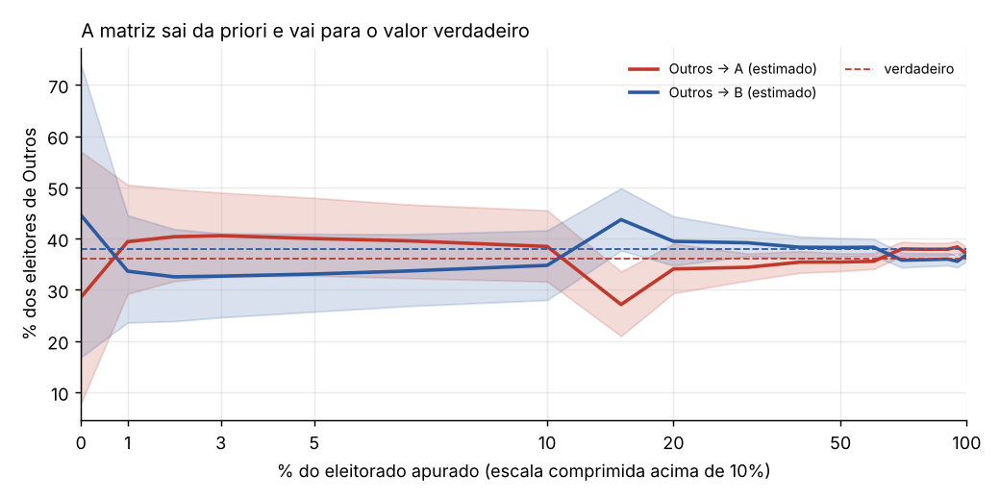
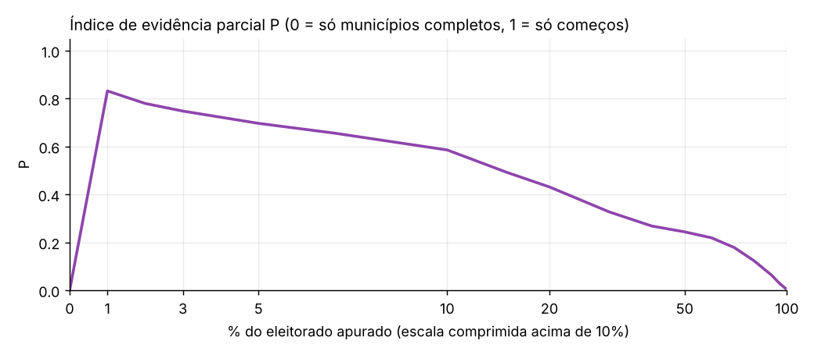
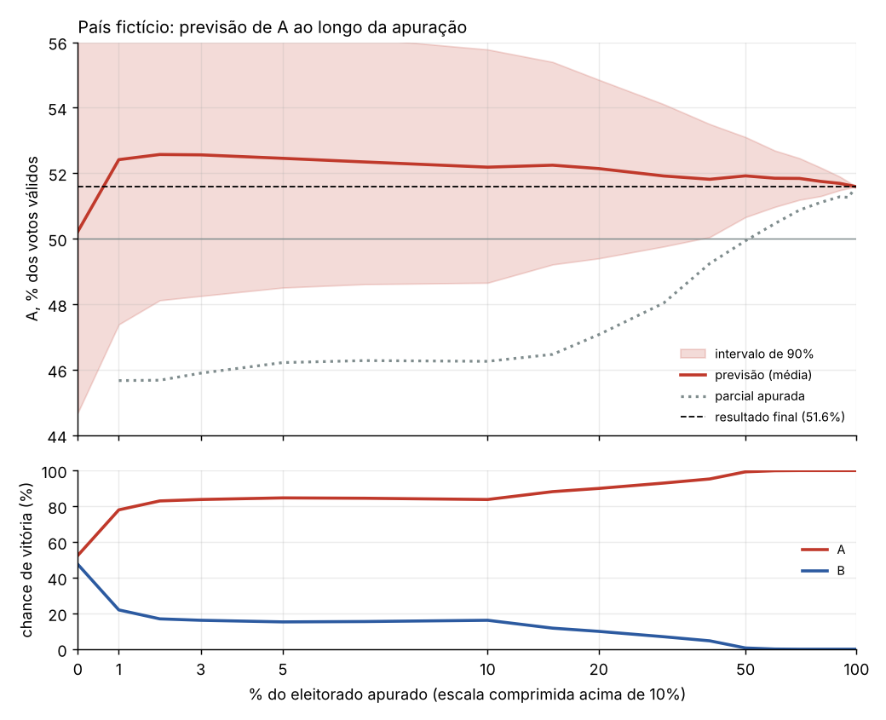
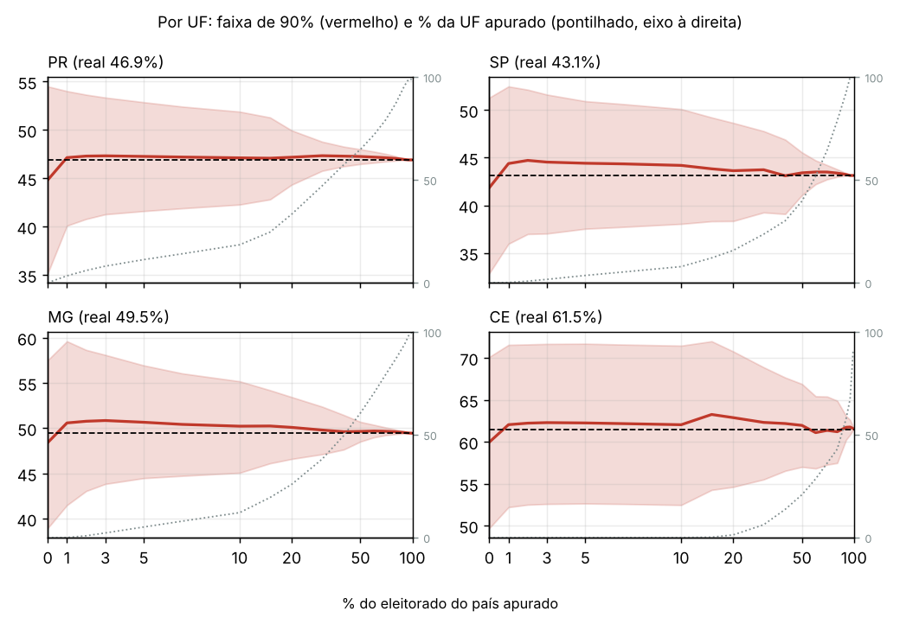
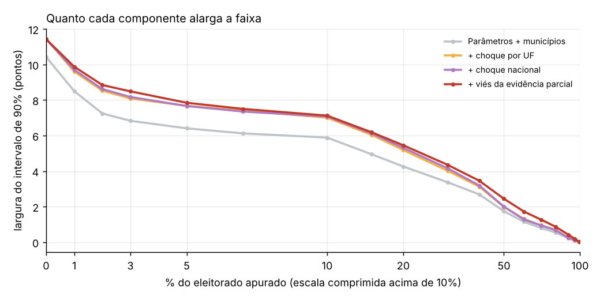

# O modelo revisado do 2º turno, passo a passo

Este documento explica como o modelo revisado (etapa 3, ver [revisao-t2.md](revisao-t2.md)) transforma uma
apuração parcial em uma previsão com faixa de incerteza. A explicação segue um **exemplo fictício**: um país
inventado com 9 UFs e 500 municípios, em que sabemos a resposta certa e acompanhamos a previsão do começo ao fim
da apuração. O código está em `eleicoes/modelos/transferencia.py`. O exemplo sai de `python scripts/exemplo_metodo.py`,
que gera os gráficos em `docs/img/metodo/` e as tabelas em `resultados/exemplo-metodo/`.

Notação: A e B são os dois candidatos do 2º turno, e o objetivo é prever a fração de A nos votos válidos.

## 1. A ideia em uma frase

O 1º turno de cada município já é conhecido. O modelo estima **para onde foi cada grupo de eleitores do 1º turno**
(quem votou em A, em B, em outros candidatos, branco/nulo ou não votou) usando os municípios já apurados. Depois
aplica essa estimativa aos municípios que faltam e sorteia milhares de cenários para medir o quanto pode errar.

## 2. A matriz de transferência

Para o município $i$, o 1º turno vira um vetor de frações do eleitorado:

$$x_i = \frac{1}{E_i}\,(A_1,\ B_1,\ O_1,\ W_1,\ N_1)$$

onde $O$ são os votos nos outros candidatos, $W$ brancos e nulos e $N$ abstenções. O 2º turno previsto é

$$\hat y_i = x_i\, M(\theta_g), \qquad \hat y_i = (A_2,\ B_2,\ W_2,\ N_2)/E_i$$

com $M$ uma matriz 5 × 4 (origem no 1º turno → destino no 2º):

| Origem \ destino | A | B | branco/nulo | abstenção |
|---|---|---|---|---|
| A | $1 - p_{AB} - p_R$ | $p_{AB}$ | 0 | $p_R$ |
| B | $p_{BA}$ | $1 - p_{BA} - p_R$ | 0 | $p_R$ |
| Outros | $o_A$ | $o_B$ | $o_W$ | $o_N$ |
| Branco/nulo | 0 | 0 | $1 - p_R$ | $p_R$ |
| Abstenção | $n_A$ | $n_B$ | 0 | $1 - n_A - n_B$ |

São 8 parâmetros $\theta$, todos em escala logística para que as probabilidades fiquem entre 0 e 1. Por
exemplo, $p_{AB} = 0{,}3\,\sigma(\theta_1)$ com $\sigma(z) = 1/(1+e^{-z})$, e a linha Outros é um softmax de
$(\theta_4, \theta_5, \theta_6, 0)$. O índice $g$ indica que cada **grupo** de municípios tem sua própria matriz.
Os grupos são as combinações de UF e porte da cidade: capitais, grandes, médias e pequenas.

### Conta de um município

No exemplo, a **priori** (a matriz da eleição anterior) acerta quase tudo, mas acha que os eleitores de Outros
vão 28% para A e 46% para B. Na verdade eles vão 36% para A e 38% para B. Este é o mesmo tipo de erro de 2026.
Um município com $x = (0{,}30;\ 0{,}34;\ 0{,}14;\ 0{,}04;\ 0{,}18)$:

$$M_{\text{priori}} = \begin{pmatrix} 0{,}93 & 0{,}01 & 0 & 0{,}06 \\ 0{,}01 & 0{,}93 & 0 & 0{,}06 \\
0{,}28 & 0{,}46 & 0{,}11 & 0{,}15 \\ 0 & 0 & 0{,}94 & 0{,}06 \\ 0{,}04 & 0{,}04 & 0 & 0{,}92 \end{pmatrix}
\quad\Rightarrow\quad \hat y = (0{,}329;\ 0{,}391;\ 0{,}053;\ 0{,}227)$$

A fica com $0{,}329 / (0{,}329 + 0{,}391) = 45{,}7\%$ dos válidos. Com a matriz verdadeira seriam 47,3%. A
diferença de 1,6 ponto vem toda da linha Outros: os 14% de eleitores de Outros × 8 pontos a mais para A.

## 3. Estimando a matriz com o que já foi apurado

Para os municípios já apurados (total ou parcialmente), o modelo compara o observado $y_i$ com o previsto
$x_i M(\theta)$ e escolhe o $\theta$ que minimiza

$$\sum_i \sum_d \left(\frac{y_{id} - (x_i M(\theta))_d}{s_{id}}\right)^2 \;+\; \sum_k \left(\frac{\theta_k - \mu_k}{\tau_k}\right)^2$$

- O primeiro termo é o ajuste aos dados. O peso de cada município é
  $s_{id}^2 = s_0^2 + s_{\text{parcial}}^2 (1 - f_i) + p_{id}(1-p_{id}) / E^{w}_i$, onde:
  - $s_0$ é a variação entre municípios, que não é ruído amostral. Ela é estimada dos resíduos e começa em 3%.
  - $s_{\text{parcial}} = 0{,}08$ dá peso menor a um município parcialmente apurado (fração apurada $f_i$),
    porque as seções que chegam primeiro vêm agrupadas (mesma zona, mesmo bairro).
  - $p(1-p)/E^w$ é o ruído amostral, que encolhe em cidades grandes.
- O segundo termo puxa os parâmetros para a priori $\mu$, com desvio $\tau$. Com poucos dados vale a priori;
  com muitos, os dados dominam.

A **incerteza dos parâmetros** vem da aproximação de Laplace, $\Sigma = (J^\top J)^{-1}$, onde $J$ é o jacobiano
dos resíduos no ponto ótimo.

### Hierarquia

A estimação é feita em cascata: Brasil → região → UF → UF × porte. A priori de cada grupo é a estimativa do grupo
de cima, mais o desvio que esse grupo tinha na eleição de referência:

$$\mu_{\text{grupo}} = \hat\theta_{\text{pai}} + \Delta_{\text{grupo}}, \qquad
\tau_{\text{grupo}}^2 = 0{,}5^2 + \operatorname{diag}(\Sigma_{\text{pai}})$$

Assim, um grupo sem nenhum município apurado herda a estimativa da vizinhança, com incerteza maior. Uma UF que
já está apurada usa os próprios dados.

### No exemplo

Antes de abrir as urnas, a estimativa é a priori (Outros → A 29%), com faixa larga. Com 1% apurado, os dados
já puxam a linha Outros para perto do verdadeiro (36% e 38%). A estimativa oscila até uns 20% apurado (perto de
15% ela chega a cruzar), porque a mistura de municípios apurados ainda muda muito. Depois de 50% ela estabiliza.

## 4. Municípios parcialmente apurados

Num município com fração $f_i$ apurada, o resultado parcial também informa sobre o que falta nele. A previsão
para as seções restantes mistura a parcial do próprio município com a previsão da matriz:

$$\hat y_i^{\text{resto}} = r_i\, y_i^{\text{parcial}} + (1 - r_i)\, x_i M(\theta_g), \qquad r_i = \frac{f_i}{f_i + 0{,}3}$$

Com 40% apurado, $r = 0{,}4/0{,}7 = 0{,}57$: a parcial pesa 57% e a matriz 43%. No município da seção 2, se a
parcial com 40% mostra A com 48,5%, o resto fica em cerca de $0{,}57 \times 48{,}5 + 0{,}43 \times 45{,}7 \approx 47{,}3\%$.
O município fecharia perto de $0{,}4 \times 48{,}5 + 0{,}6 \times 47{,}3 \approx 47{,}8\%$. O cálculo de verdade é feito em frações do
eleitorado, não em % dos válidos, mas a ideia é a mesma.

O resultado final de cada município é **o que já foi apurado mais a previsão para o que falta**:

$$\text{final}_i = \text{apurado}_i + (E_i - E^a_i)\, \hat y_i^{\text{resto}}$$

Quando o município termina, $E_i = E^a_i$ e ele deixa de ter incerteza.

## 5. A incerteza: 1000 cenários

A previsão não é um número só. O modelo sorteia $S = 1000$ cenários, e cada um tem cinco fontes de variação:

1. **Parâmetros.** Cada cenário sorteia um $\theta$ para cada grupo,
   $\theta_g^{(s)} = \mu_g + L_g\big(\sqrt{\rho}\, z^{(s)} + \sqrt{1-\rho}\, \varepsilon_g^{(s)}\big)$, com $L_g L_g^\top = \Sigma_g$
   e $\rho = 0{,}5$. Metade da variação é comum ao país inteiro ($z$) e metade é própria do grupo ($\varepsilon$).
2. **Município.** Um ruído $N(0, s_0)$ na fração de A e de B do que falta em cada município.
3. **Choque por UF.** Um desvio comum a todos os municípios da UF, na margem A − B do que falta:
   $$c_{u}^{(s)} \sim N\!\left(0,\ \sigma_{UF} + \sigma_{\text{início}}\left(1 - \tfrac{E^a_u}{E_u}\right)\right),
   \qquad \sigma_{UF} = 2\%,\ \sigma_{\text{início}} = 4\%$$
   Uma UF sem nada apurado tem desvio de 6%; uma quase toda apurada, de 2%.
4. **Choque nacional.** Um desvio $N(0;\ 1\%)$ comum ao país inteiro, também na margem do que falta.
5. **Viés da evidência parcial.** Um desvio $v^{(s)} \sim N(0;\ 1{,}5\%)$, comum ao país, que representa a chance
   de as seções que chegaram primeiro não representarem as que faltam. Ele entra com peso
   $$\text{fator}_i = \begin{cases} 1 & \text{se o município já começou e não terminou} \\ P & \text{se ainda não começou} \end{cases}
   \qquad P = 1 - \frac{\sum_i E^a_i f_i}{\sum_i E^a_i}$$
   $P$ mede quão "parcial" é o que já foi apurado. Se só entraram municípios completos, $P = 0$. Se só entraram
   começos de municípios, $P \approx 1$. Antes de abrir, $P = 0$, porque não há evidência para estar enviesada.

Os choques 2 a 4 são multiplicados por $1 - r_i$, porque a parte que vem da parcial do município já carrega a
realidade dele. O viés 5 não é, porque o próprio resultado parcial pode ser o enviesado.

Em cada cenário, as previsões dos municípios são somadas para dar o total do país, das regiões e das UFs. A
**previsão** é a média dos cenários, o **intervalo de 90%** vai do percentil 5 ao 95, e a **chance de vitória**
é a fração dos cenários em que A passa de 50% dos válidos.

No exemplo, $P$ salta para 0,83 com 1% apurado, porque quase tudo o que chegou são começos de municípios. Depois
cai devagar, até 0,24 com 50% e 0 no fim. Em 2026 foi parecido: 0,67 com 3% e 0,2 com 50%.

## 6. A apuração no tempo

O exemplo tem os vieses que vimos em 2026: o Sul e o Sudeste apuram antes, o Nordeste e as capitais depois, e as
primeiras seções de cada cidade vêm 3 pontos de margem mais para A do que a cidade inteira. O resultado final é
A com 51,6%.

| % apurado | Parcial (A) | Previsão | Intervalo de 90% | Chance de A |
|---|---|---|---|---|
| 0 | — | 50,2 | 44,7 – 56,1 | 53% |
| 1 | 45,7 | 52,4 | 47,4 – 57,3 | 78% |
| 5 | 46,2 | 52,5 | 48,5 – 56,4 | 85% |
| 10 | 46,3 | 52,2 | 48,7 – 55,8 | 84% |
| 20 | 47,1 | 52,1 | 49,4 – 54,9 | 90% |
| 30 | 48,0 | 51,9 | 49,8 – 54,1 | 93% |
| 50 | 49,9 | 51,9 | 50,7 – 53,1 | 99% |
| 70 | 50,9 | 51,8 | 51,2 – 52,5 | 100% |
| 90 | 51,3 | 51,7 | 51,5 – 51,9 | 100% |
| 99 | 51,5 | 51,6 | 51,58 – 51,62 | 100% |

Como ler a noite:

- **Antes de abrir (0%).** Só há a priori. A previsão fica em 50,2%, 1,4 ponto abaixo do real, por causa do erro na
  linha Outros. A faixa é larga (11 pontos) porque a única informação é a eleição anterior.
- **Primeiros minutos (1–5%).** A parcial mostra A com 45,7%, porque chegaram primeiro as UFs mais favoráveis a B.
  A previsão, porém, sobe para 52,4%. O modelo não lê a parcial nacional, e sim como cada município votou em
  relação ao próprio 1º turno. Esses municípios mostram que os eleitores de Outros estão indo mais para A do que a
  priori dizia. A previsão passa um pouco do real porque as primeiras seções de cada cidade estão mais para A
  (o viés de 3 pontos). É justamente para isso que existe o viés da evidência parcial, e a faixa continua cobrindo o
  resultado.
- **Meio da noite (10–50%).** Entram os municípios completos e o Nordeste. $P$ cai, os choques por UF encolhem, e a
  faixa estreita de 7 para 2,5 pontos. A previsão desce devagar para o real, e a chance de A passa de 99% perto
  de 50% apurado.
- **Fim (70–100%).** O que falta é pouco, então os choques quase não têm o que deslocar. A previsão e a parcial se
  encontram no resultado final.

Em todos os pontos, o resultado final (51,6%) fica dentro do intervalo de 90%. Uma única apuração não prova que a
faixa está bem calibrada; isso é medido em muitas apurações sintéticas no [teste de estresse](estresse.md), que deu
95% de cobertura.

### Por UF

Uma UF sem nada apurado tem faixa bem mais larga que o país (choque de 6% na margem, mais a incerteza dos
parâmetros do grupo). O Ceará, por exemplo, fica sem nada apurado até uns 20% do país, mas a previsão dele já se
move com o que se aprende nas outras UFs, através da hierarquia e da parte comum ($\rho$) dos parâmetros. A faixa
de cada UF só fecha de fato quando a própria UF apura.

## 7. De onde vem a largura da faixa

Para separar as contribuições, o exemplo foi rodado ligando os componentes um a um:

- **Parâmetros + municípios** (cinza) é a maior parte da faixa em quase toda a noite. No começo, ela reflete o
  quanto a priori pode estar errada. Depois, o quanto a matriz estimada pode errar nos municípios que faltam.
- **Choque por UF** (laranja) acrescenta cerca de 1 ponto entre 1% e 30% apurado, quando há UFs inteiras ainda sem
  dados.
- **Choque nacional** (roxo) quase não aparece somado aos outros, porque desvios independentes se somam em quadratura (a soma é dos quadrados). Ele importa
  mais quando os outros componentes são pequenos.
- **Viés da evidência parcial** (vermelho) pesa entre 30% e 80%. É quando a faixa sem ele ficaria estreita demais
  para o risco de as seções restantes das cidades virem diferentes das primeiras.

As escalas (2%, 4%, 1% e 1,5%) foram calibradas no rejogo da apuração real de 2026, no backtest de 2022 e em
32 apurações sintéticas ([revisao-t2.md](revisao-t2.md) e [estresse.md](estresse.md)).

## 8. Limites conhecidos

- **A previsão de antes da apuração depende da priori.** Se a eleição anterior não representa bem a atual, o centro
  erra, como aconteceu em 2026. A base histórica de 2006 a 2024 (etapa 2) serve para calibrar a priori e o tamanho
  desse erro.
- **A matriz é simples.** Branco e nulo não vão para A nem para B, e a abstenção é igual entre eleitores de A e de B.
  A versão `matriz_v2` relaxa isso, mas ainda não foi adotada.
- **O modelo só vê totais por município.** Um viés forte na ordem das seções dentro das cidades, maior do que o
  calibrado, não tem como ser separado de uma virada real (ver a ordem "adversa" em [revisao-t2.md](revisao-t2.md)).
- **No meio da noite, as faixas das UFs são largas demais.** O intervalo de 50% cobre cerca de 80% das vezes. É um
  ajuste fino pendente da etapa 4.
